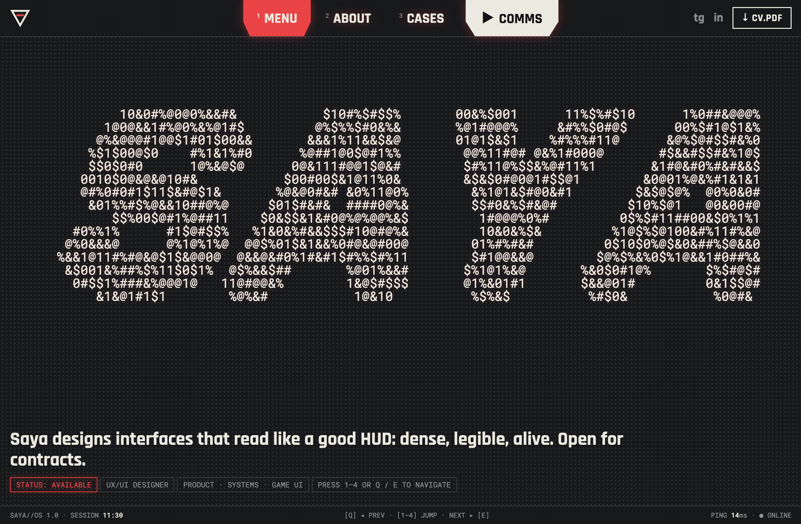

# Saya — UX/UI Designer Portfolio (Concept v1)

A portfolio that behaves like a game terminal instead of a website. It takes its cues from the in-game interfaces of Cyberpunk 2077 and VALORANT: dense panels, chamfered menu tabs, inventory slots, match history and a lobby-style contact flow.

> **Concept v1.** This is the first of several design concepts, built to explore one direction. It is not the final portfolio, and all names, projects, jobs and contact details are placeholders.

## Concept

- **No scrolling.** Every screen fits in one viewport, like a menu in a game.
- **Signal red on charcoal.** One accent colour with soft glow on red elements only. No purple, no neon.
- **ASCII everywhere.** The hero name, portrait, case-study previews and the comms radar are animated live in ASCII.
- **Persistent top navigation.** VALORANT-style tabs, with a plain CV download and compact `tg` / `in` links always visible. On mobile the tabs move to a bottom bar.

## Sections

| Screen | Inspiration | What it shows |
| --- | --- | --- |
| Menu | Game main menu | Animated ASCII name, who I am and what I do |
| About | Agent select / character page | Dossier, attribute bars, skill inventory, and a Career record tab (match history, achievements) |
| Case Files | Mission select | Four case studies with Brief / Process / Result tabs |
| Comms | Play button | Contact as a matchmaking lobby: **Start → Searching → Match found → Accept** |

## Controls

`Q` / `E` or the arrow keys switch screens, and `1`–`4` jump straight to one.

## Run it

Open `index.html` in a browser. It is a single file with no build step; the only external request is Google Fonts (Rajdhani and Roboto Mono). To publish, enable GitHub Pages on the `main` branch.

## Make it yours

In `index.html`, edit `CASES`, `JOBS`, `ITEMS`, `ATTR`, `ACH` and `MAIL`, update the `tg` and `in` links, and add `resume.pdf` next to the file.
